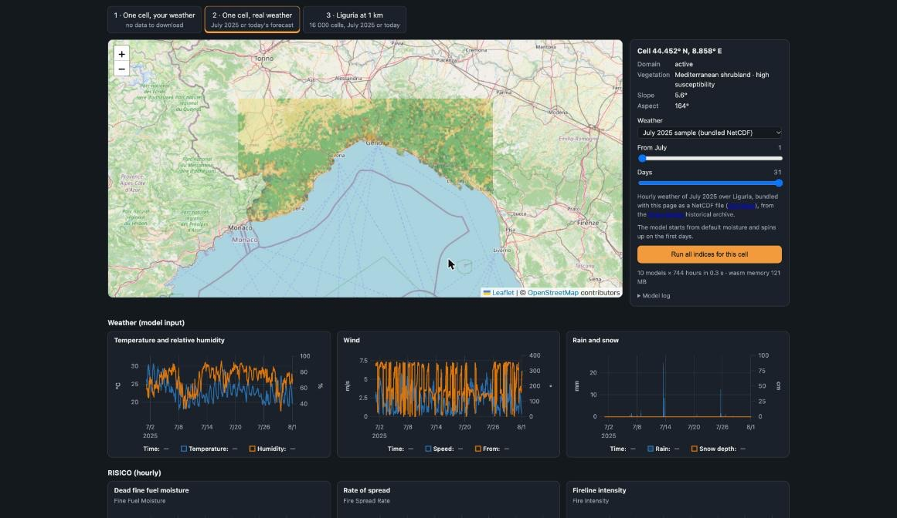
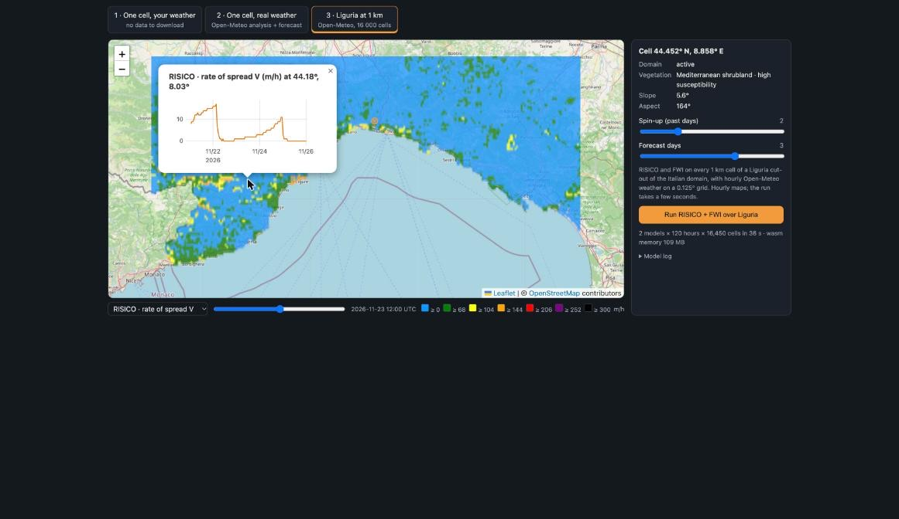

# Interactive Demo

This page runs the real RISICO program in your browser, with nothing to install: the same
`risico-2023` used operationally, compiled to WebAssembly. It covers a 1 km grid over Liguria,
in north-western Italy. Your browser prepares the input files, runs the model and draws its
outputs; no data is sent to a server.

Three levels, from a single cell to a regional map:

1. **One cell, your weather.** Pick a cell on the map, set a weather scenario with the sliders and,
   if you like, change its vegetation, slope and aspect. Nothing is downloaded: all ten models run on
   one cell in well under a second.
2. **One cell, real weather.** The same cell driven by real hourly weather: July 2025, bundled with
   the page as a NetCDF file, or today's analysis and forecast from [Open-Meteo](https://open-meteo.com).
3. **Liguria at 1 km.** RISICO and FWI on the 16 000 cells of a Liguria cut-out of the Italian
   domain, with the same choice of weather on a 0.125° grid. Browse the maps in time and click a cell
   for its series.

<iframe
  src="app.html"
  title="RISICO WebAssembly demo"
  loading="lazy"
  style="width:100%; min-height:1500px; border:1px solid var(--md-default-fg-color--lightest); border-radius:10px;">
</iframe>

## What it does

### 1 · One cell, your weather

Click any cell of the map: the panel shows its vegetation, slope and aspect, read from the
land data. Set a weather scenario (start date, length, mean temperature and daily
range, humidity, wind, a rain event) and, if you like, override the vegetation class, slope
and aspect. **Run all indices** runs the ten models on that cell.

The results come as interactive charts, grouped by model: the weather actually used,
RISICO hourly (fine fuel moisture, rate of spread, intensity, wind and temperature effects),
the FWI moisture codes and behaviour indices, and every other index.

### 2 · One cell, real weather

The same cell with real hourly weather. By default the page uses its **July 2025 sample**, a
NetCDF input bundled with the site, so nothing is requested from outside: pick the first day and
the length of the period. Alternatively, **Today** requests the analysis of up to two months
before now and up to ten days of forecast from Open-Meteo; a dashed line marks the current time.

### 3 · Liguria at 1 km

RISICO and FWI on every cell of the domain, on any period of the July 2025 sample (a week takes
a few seconds) or on today's forecast. When the run ends, pick a variable and move through time
with the slider; the legend uses the operational palettes.

Click a cell for its full series of the selected variable:

!!! note "About this demo"
    In the browser the model runs on one processor core; the installed program uses all of
    them. Every run starts from default moisture, with no [warm state](concepts.md), and
    spins up on the first days of weather. That is enough for the fine fuel moisture of RISICO, but slow codes such as the FWI
    drought code (DC) or KBDI need months to settle. Mark 5 and KBDI use a mean annual rainfall of
    800 mm and Orieux a heat index of 70 for every cell.

    The July 2025 sample comes from the Open-Meteo historical forecast archive and is served with the
    site; weather data by [Open-Meteo.com](https://open-meteo.com), licensed under
    [CC BY 4.0](https://creativecommons.org/licenses/by/4.0/); the same files run with the command-line model, see
    [Run the sample](getting-started.md#run-the-sample). Today's weather is
    requested by your browser from Open-Meteo's free API: 2 m temperature and humidity, 10 m wind,
    precipitation and snow depth. The free tier allows about 600 locations a minute; the Liguria map
    needs about 200, and the page waits and retries if the limit is reached.

See [Building the Web Demo](web-demo.md) for how the bundle is built.
