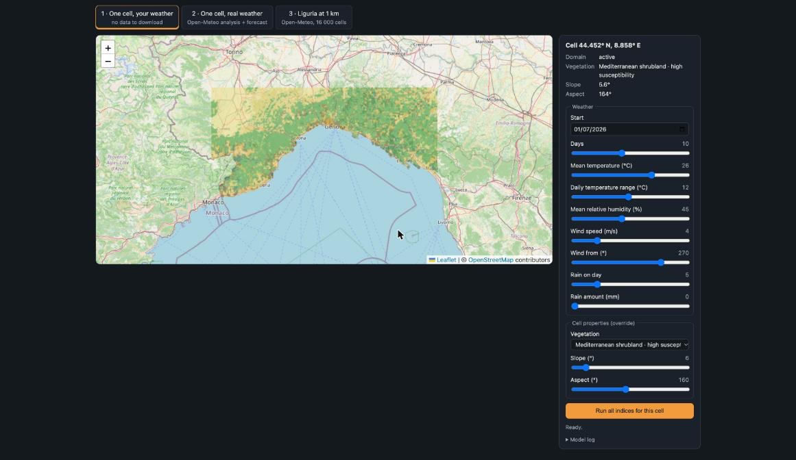
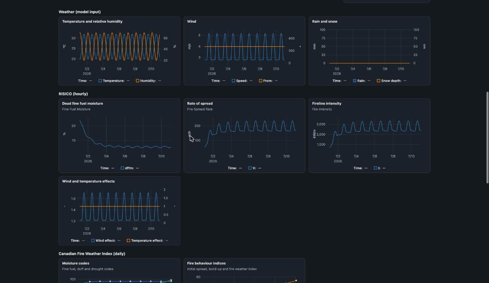
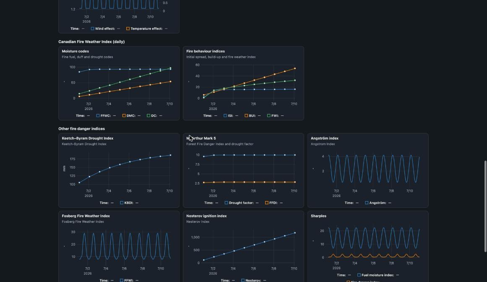
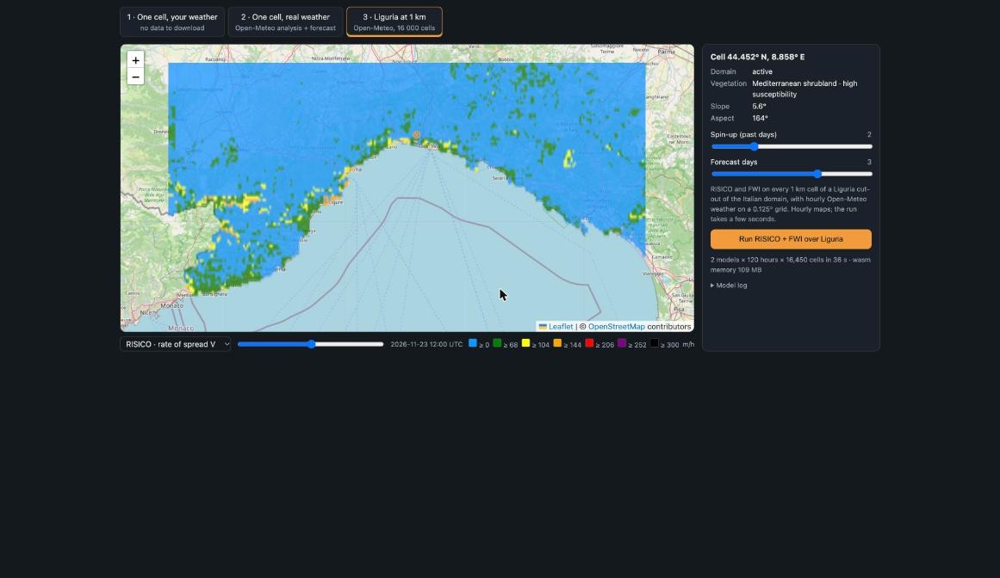
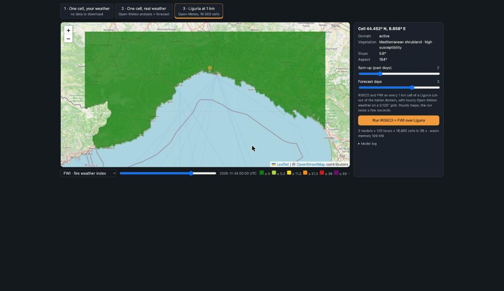

# Interactive Demo

The `risico-2023` binary is compiled to **WebAssembly** (`wasm32-wasip1`) and runs entirely in your
browser: no server, no upload. It is the same program as the operational build. The page writes its
weather inputs as NetCDF files and its static layers as GeoTIFFs into an in-memory filesystem, runs the
binary on them in a Web Worker, and reads back the NetCDF-4 files it writes.

Three levels, from a single cell to the whole country:

1. **One cell, your weather.** Pick a cell on the map, set a weather scenario with the sliders and,
   if you like, change its vegetation, slope and aspect. Nothing is downloaded: all ten models run on
   one cell in well under a second.
2. **One cell, real weather.** The same cell driven by hourly weather from
   [Open-Meteo](https://open-meteo.com): a spin-up on the past days, then the forecast. The dashed line
   marks the current time.
3. **Liguria at 1 km.** RISICO and FWI on the 16 000 cells of a Liguria cut-out of the Italian
   domain, with hourly Open-Meteo weather on a 0.125° grid. Browse the maps in time and click a cell
   for its series.

<iframe
  src="app.html"
  title="RISICO WebAssembly demo"
  loading="lazy"
  style="width:100%; min-height:1500px; border:1px solid var(--md-default-fg-color--lightest); border-radius:10px;">
</iframe>

## What it does

### 1 · One cell, your weather

Click any cell of the domain, a 1 km cut-out of the Italian one around Liguria: the panel shows its vegetation, slope and aspect from
the static layers. Set a weather scenario (start date, length, mean temperature and daily
range, humidity, wind, a rain event) and, if you like, override the vegetation class, slope
and aspect. **Run all indices** runs the ten models on that cell.

The results come as interactive charts, grouped by model: the weather actually used,
RISICO hourly (fine fuel moisture, rate of spread, intensity, wind and temperature effects),
the FWI moisture codes and behaviour indices, and every other index.

### 2 · One cell, real weather

The same cell with hourly analysis and forecast from Open-Meteo: a spin-up on up to two
weeks of past weather, then up to a week of forecast. The dashed line marks now.

### 3 · Liguria at 1 km

RISICO and FWI on every cell of the domain. When the run ends, pick a variable and move
through time with the slider; the legend uses the operational palettes.

Click a cell for its full series of the selected variable:

!!! note "About this demo"
    The run is **single-threaded**, since `wasm32` has no threads; the native build processes tiles in
    parallel. Every run starts from default moisture (`on_missing: defaults`) and spins up on the past
    days of weather. That is enough for the fine fuel moisture of RISICO, but slow codes such as the FWI
    drought code (DC) or KBDI need months to settle. Mark 5 and KBDI use a mean annual rainfall of
    800 mm and Orieux a heat index of 70 for every cell.

    Weather comes from Open-Meteo's free API, requested by your browser: 2 m temperature and humidity,
    10 m wind, precipitation and snow depth. The free tier allows about 600 locations a minute; the
    Liguria map needs about 200, and the page waits and retries if the limit is reached.

See [Building the Web Demo](web-demo.md) for how the bundle is built.
